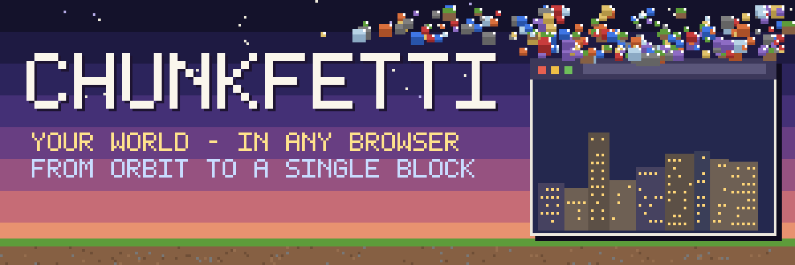

<p align="center">
  
</p>

<p align="center">
  <a href="https://github.com/sanjay-bhat/chunkfetti/releases"></a>
  
  
  
  
  
</p>

# chunkfetti

**Throw your block world into the browser.** chunkfetti turns a saved Java Edition world into streaming 3D tiles, then
lets anyone fly through it in a web page: from a whole-world outline in orbit, down to a single block, the underground
included. No game server, no plugins on a live server, no editing: just files you can put on any static host.

> **Status: early days.** The command line, the release pipeline and the viewer shell are in place; tiling is the
> next milestone. Watch the releases.

## Why another map?

Existing web maps are brilliant for survival servers. chunkfetti is aimed at the other end:

| | chunkfetti |
|---|---|
| **Huge worlds** | Built for city-scale, 1:1 builds: millions of chunks |
| **Underground on** | Tunnels, subways, caves and interiors are in the default view, not a cut-away afterthought |
| **Orbit to block** | Hierarchical level of detail: an outline from far away, sharpening tile by tile as you zoom in |
| **Everything in the world** | Modded blocks render from the mods' own models and textures |
| **Static** | Output is plain files: Cloudflare Pages, GitHub Pages, S3, a USB stick |
| **Small on the wire** | Compact meshes, GPU-ready textures, Brotli |
| **Kind to laptops** | Uses half the cores by default and rebuilds only tiles whose chunks changed |

## How it works

```
saved world ──► chunkfetti build ──► tiles/ (meshes + textures + tile tree) ──► chunkfetti viewer (browser)
                    ▲
   your own game install and mods (textures and models are read here, never shipped)
```

- **Builder** (`crates/chunkfetti`, Rust): reads region files, meshes chunks, simplifies them level by level, packs
  the textures it finds in *your* game and mod jars, and writes a tile tree.
- **Viewer** (`viewer/`, TypeScript + three.js): streams the tile tree, refining what is near the camera; WebGPU where
  the browser has it, WebGL 2 everywhere else.

## Quick start

Download the builder for your system from the [latest release](https://github.com/sanjay-bhat/chunkfetti/releases),
then:

```bash
chunkfetti doctor
```

```bash
chunkfetti build path/to/saves/MyWorld -o MyWorld.tiles
```

Or let Claude do the whole thing: open this repo in [Claude Code](https://claude.com/claude-code) and ask it to
"set up chunkfetti for my world". The bundled skill (`.claude/skills/chunkfetti`) checks your system, asks before
downloading anything, finds your game and worlds, builds the tiles and opens a preview.

Just want the pieces? The builder is a single binary and the viewer is a plain package: use either on its own.

## Game files and licences

chunkfetti is code only. **It contains no game assets.** Block textures and models belong to Mojang and to each mod's
authors; the builder reads them from the copies already installed on the user's computer at build time, and this
repository never includes them. If you publish tiles you built, you are publishing renders of your world, which is
your call to make under the game's and the mods' terms.

NOT AN OFFICIAL MINECRAFT PRODUCT. NOT APPROVED BY OR ASSOCIATED WITH MOJANG OR MICROSOFT.

## Releases

Every change merged to `main` ships as a release, versioned from the commit message
(see [CONTRIBUTING.md](CONTRIBUTING.md)): `fix:` bumps the patch, `feat:` the minor, and each release carries the
builder for macOS, Linux and Windows plus the viewer.

## Licence

Dual-licensed under [MIT](LICENSE-MIT) or [Apache 2.0](LICENSE-APACHE), at your option.
